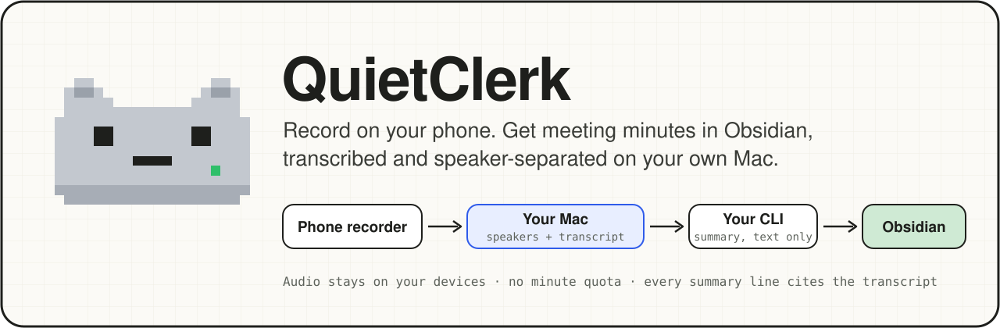
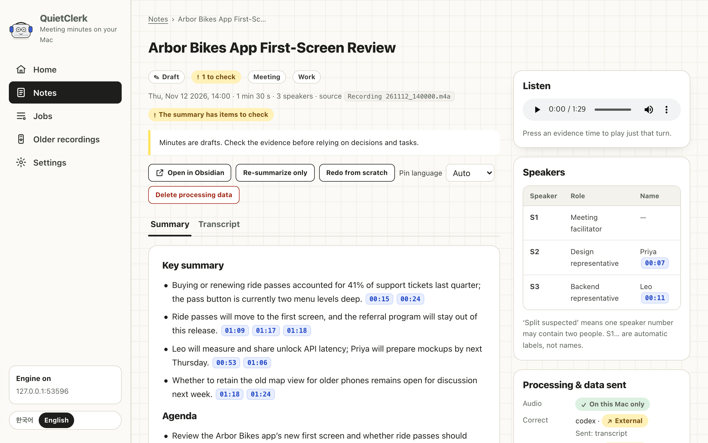
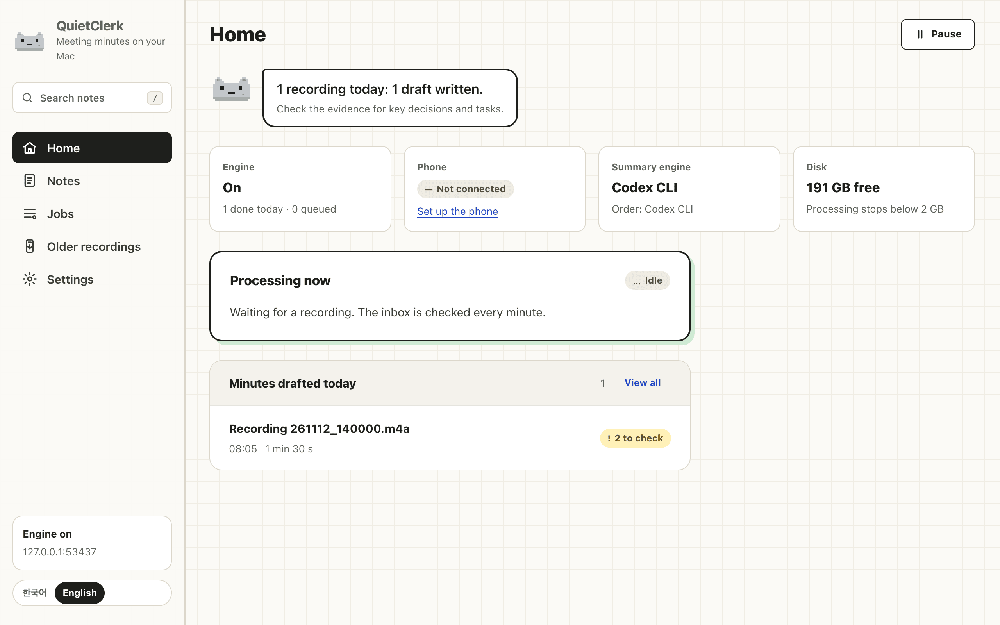
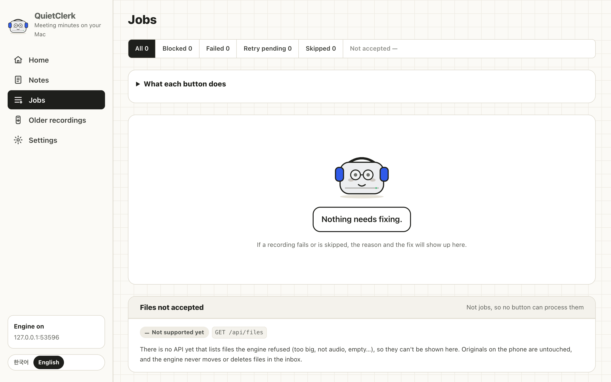
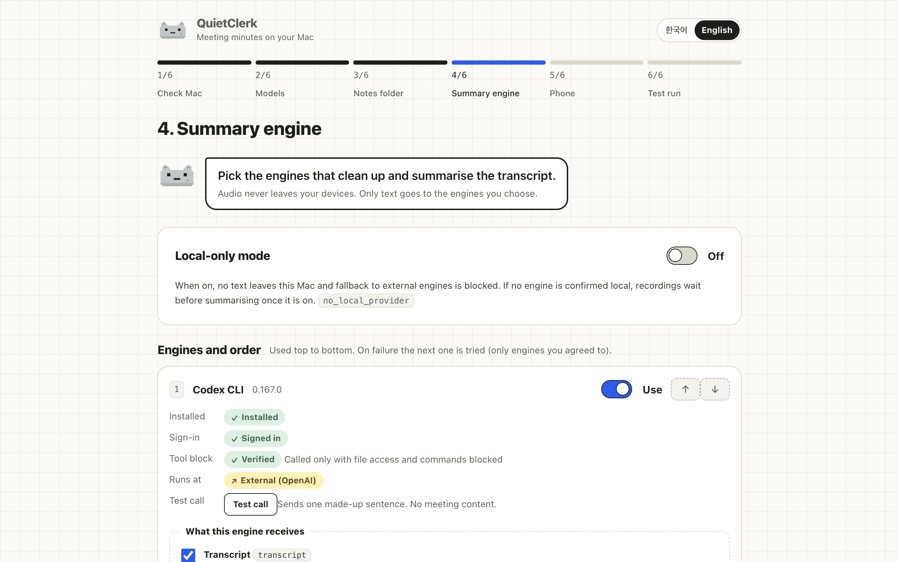
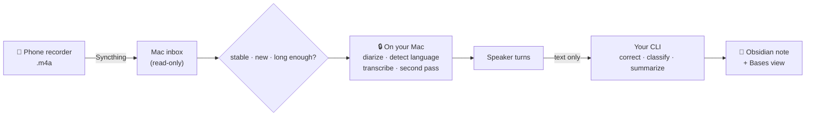

<p align="center">
  
</p>

<p align="center">
  <a href="https://github.com/minigold92/rec2vault/actions/workflows/test.yml"></a>
  
  
  
  <a href="LICENSE"></a>
</p>

<p align="center">
  <b>English</b> · <a href="README.ko.md">한국어</a> · <a href="docs/how-it-works.md">How it works</a> · <a href="docs/benchmark.md">Benchmark</a>
</p>

---

Record a meeting with the voice recorder already on your Android phone and save it. A few minutes
later a meeting note appears in your Obsidian vault: who said what, a short summary, decisions and
tasks, and every line linked back to the moment it was said.

The audio is transcribed and split by speaker **on your own Mac** with local models. Only the text
goes to an AI command-line tool you already use (Codex CLI or Claude Code) to clean it up and write
the summary, or nowhere at all in local-only mode.

> [!NOTE]
> **Developer preview.** Runs daily on one Mac mini with Korean work meetings. Installing takes a
> terminal and about ten minutes; a signed Mac app is planned.

<p align="center">
  
  <br><sub>The minutes screen for a fictional meeting. Each time chip plays the exact turn it comes from.</sub>
</p>

## Why

AI voice recorders pair a dedicated device with cloud transcription and monthly minute plans. An
Android phone already records well and an Apple Silicon Mac can run speech models, so QuietClerk
does the same job with hardware you probably own:

| | Dedicated AI recorder | QuietClerk |
|---|---|---|
| Record | buy a recorder | the phone's built-in recorder, unchanged |
| Transcribe | vendor cloud, minute quota | your Mac, no quota |
| Summarize | vendor model | the CLI you already pay for, or a local model |
| Result | vendor app | Markdown in your Obsidian vault |

## What you get

- **Hands-off.** Save a recording and walk away. The phone syncs it, the Mac picks it up once the
  file stops changing, and a note appears. Failed steps retry; nothing is processed twice.
- **Guarded transcription.** Repeat loops and phrases models invent in silence are cut and listed;
  a word list of your names and terms steers recognition and fixes known mishearings.
- **Speakers and timestamps.** Local diarization (NVIDIA Nemotron 3) and transcription
  (Qwen3-ASR 1.7B with word alignment, plus a Whisper second pass) on Apple Silicon via MLX.
- **Short, checkable minutes.** Key summary, decisions, open issues and tasks with owner and
  deadline. Every sentence ends with links like `[[#^t12|01:23]]` to the transcript line it came
  from, so you can check it in seconds. Owners, deadlines and numbers are then checked against those
  lines in code; anything the cited line does not say is marked for review, and "next Friday" becomes
  a date.
- **Your edits survive.** Change the title, tick tasks or write notes in Obsidian; re-running the
  summary rewrites only the engine's section.
- **Korean and English.** The language is detected per recording; notes come out in the meeting's
  language (or one you pin).
- **You decide what leaves the Mac.** Pick which engines may receive text and which fields
  (transcript, file name, project list). Local-only mode blocks every external call.

## Screens

<table>
  <tr>
    <td width="33%"></td>
    <td width="33%"></td>
    <td width="33%"></td>
  </tr>
  <tr>
    <td align="center"><sub><b>Home</b> · what is happening now</sub></td>
    <td align="center"><sub><b>Jobs</b> · why something was skipped or failed</sub></td>
    <td align="center"><sub><b>Setup</b> · engines and what they receive</sub></td>
  </tr>
</table>

The screens are served by the engine on `127.0.0.1` only, behind a one-time login token.

## How it works



One long-running service (`quietclerk serve`, a launchd agent) watches the inbox, runs one recording
at a time and keeps every stage's output, so an interrupted job resumes where it stopped. The local
models run in separate processes and are downloaded once. A step-by-step walkthrough with the real
intermediate files of one fictional meeting is in **[docs/how-it-works.md](docs/how-it-works.md)**.

### What leaves your Mac

| Data | Where it goes |
|---|---|
| Audio | Nowhere. Phone → your Mac over Syncthing, processed locally. |
| Transcript text | The engines you enabled, with the fields you agreed to. None in local-only mode. |
| File name, project list | Only if you agreed to send them (used for the title and project). |
| Notes | Your vault folder. The note lists which engines received text. |
| Update check | Once a day the Mac asks GitHub whether this checkout has new commits (`git fetch`). Nothing about your meetings is sent. Turn off in Settings. |

Model downloads come from Hugging Face on first install; processing runs with `HF_HUB_OFFLINE=1`.

## Speed and accuracy

Measured on a **Mac mini M4 (16 GB)** with real Korean work meetings
([details](docs/benchmark.md)):

| | |
|---|---|
| Local stages | about 0.11–0.12 × the recording length, peak memory about 5 GB |
| End to end | an 18-minute meeting became a note in 7 min 41 s (Codex in Fast mode) |
| Transcription | 15–22 % character distance to two commercial Korean services, which differ from each other by 16–21 % |
| Speakers | 0.78–0.94 frame agreement; meetings with many speakers are the weak spot |

There is no human ground truth for these recordings, so the accuracy numbers are relative to
commercial services, not absolute. Summary quality has been judged only by the author.

## Requirements

- **An Apple Silicon Mac** that stays on and logged in (16 GB tested). About 6 GB of disk for models.
- **Homebrew** with `uv` and `ffmpeg`: `brew install uv ffmpeg`
- **A summary engine:** [Codex CLI](https://github.com/openai/codex) (tested daily) or
  [Claude Code](https://docs.anthropic.com/en/docs/claude-code), logged in with your subscription.
  [Ollama](https://ollama.com) for local-only use is experimental.
- **An Android phone** with [Syncthing-Fork](https://github.com/Catfriend1/syncthing-android) and
  [Syncthing](https://syncthing.net) on the Mac. Tested with a Galaxy S25 Ultra's built-in recorder;
  any recorder that saves `.m4a` files to a folder should work.

## Install

```sh
brew install uv ffmpeg
codex login                       # or: claude, then /login

git clone https://github.com/minigold92/rec2vault.git && cd rec2vault
deploy/install.sh                 # creates ~/QuietClerk, downloads models, starts the service
deploy/setup.sh open              # opens the setup screens in your browser
```

The setup screens walk through six steps: check this Mac, download models, choose the notes folder
(inside your vault), choose engines and what they may receive, connect the phone, and a test
recording. Then record five minutes or more on the phone and save.

<details>
<summary><b>Connecting the phone by hand</b></summary>

1. Pair the phone and the Mac in Syncthing.
2. On the phone, share `Recordings/Voice Recorder` as **Send Only** and exempt Syncthing-Fork from
   battery optimization.
3. On the Mac, accept the share into `~/QuietClerk/inbox` as **Receive Only**.

Recordings made before the install time are skipped; pick older ones on the **Older recordings**
screen. Syncthing-Fork 2.1.3: if the save button stays grey after choosing the folder, rotate the
phone once.
</details>

<details>
<summary><b>Update, status and uninstall</b></summary>

When a new version is out, a bar appears at the top of every screen. Press **Update**: QuietClerk
pulls the new code, swaps it in and reconnects the page, or rolls back if anything fails. If a
recording is being processed, the update waits until it finishes. From a terminal:

```sh
git pull && deploy/setup.sh update     # same as the Update button
deploy/setup.sh status                 # engine state as JSON
deploy/setup.sh doctor                 # machine, models and service checks

# uninstall (your notes stay where they are)
launchctl bootout gui/$(id -u)/local.quietclerk.serve
rm ~/Library/LaunchAgents/local.quietclerk.serve.plist
rm -rf ~/QuietClerk "$HOME/Library/Application Support/QuietClerk"
```
</details>

## Example note

<details>
<summary>Markdown the engine wrote for the fictional meeting above (excerpt)</summary>

```markdown
---
title: Arbor Bikes App First-Screen Review
date: '2026-11-12'
started_at: '2026-11-12T14:00:00'
duration_min: 1.5
language: en
type: meeting
speakers:
- 'S1: Meeting facilitator'
- 'S2: Priya · Design representative'
- 'S3: Leo · Backend representative'
status: draft
external_text_to:
- codex
---
## Tasks
- [ ] Measure unlock API latency and share the results (Leo / deadline to be set after checking the sprint). [[#^t10|00:53]] [[#^t11|01:02]] ^task-1
- [ ] Prepare mockups (Priya / next Thursday). [[#^t12|01:06]] ^task-2

## Meeting record

> [!summary] Key summary
>
> - Buying or renewing ride passes accounted for 41% of support tickets last quarter; the pass button is currently two menu levels deep. [[#^t4|00:15]] [[#^t5|00:24]]
> - Ride passes will move to the first screen, and the referral program will stay out of this release. [[#^t13|01:09]] [[#^t14|01:17]] [[#^t15|01:18]]

## Decisions

- Move ride passes to the first screen. [[#^t13|01:09]] [[#^t14|01:17]] [[#^t15|01:18]]

## Full transcript

**[00:53] S3**: Sure I'll measure the unlock API latency and share it I can't promise a date yet I need to check the sprint first ^t10

## Notes
```

The script said "Harbor Bikes"; the transcript heard "Arbor". The full input, script and every
intermediate file are in [docs/examples/demo-meeting-en](docs/examples/demo-meeting-en).
</details>

## Configuration

Settings live in `~/QuietClerk/settings.toml` and are edited on the **Settings** screen. Changes
apply from the next recording.

| Key | Default | Meaning |
|---|---|---|
| `output` | `~/QuietClerk/notes` | Notes folder, ideally inside your Obsidian vault |
| `since` | install time | Skip recordings made before this time |
| `min_duration_sec` | `300` | Skip shorter recordings |
| `language.mode` | `auto` | `auto`, `ko` or `en` |
| `notes.output_language` | `same` | Write notes in the meeting's language, or always `ko`/`en` |
| `providers.order` | — | Engines to try, in order (`codex`, `claude`, `ollama`, `omp`) |
| `providers.consent` | — | Fields each engine may receive |
| `providers.local_only` | `false` | Block every external engine |
| `providers.codex.speed` | `standard` | `fast` uses Codex Fast mode (about 1.4× faster, more plan usage) |
| `updates.check` | `true` | Check GitHub for a new version once a day |
| `vocabulary.terms` | — | Names and terms to listen for (up to 200); also given to the correction engine if you allow `vocabulary` |
| `vocabulary.replace` | — | Exact fixes applied locally after transcription, e.g. `{from = "책 마루", to = "책마루"}` |

Environment variables `QC_ROOT`, `QC_OUTPUT`, `QC_SINCE`, `QC_LANGUAGE`, `QC_LOCAL_ONLY` and
`QC_PORT` override the file.

## Limitations

- macOS on Apple Silicon only (MLX). A CUDA backend for Windows and Linux is on the roadmap.
- Meetings with five or more speakers diarize noticeably worse; overlapping speech is not separated.
- Notes are drafts. Check decisions and tasks against their linked lines before relying on them.
- Some screens still show disabled buttons for features without an API yet (model download
  progress, restoring deleted recordings, automatic Syncthing pairing).

## Development

```sh
uv run --python 3.12 --no-project --with pytest --with pyyaml --with starlette --with uvicorn \
  --with jinja2 --with httpx --with jsonschema --with numpy python -m pytest -q tests
```

The tests use synthetic audio and fake engines; they do not load MLX models. See
[CONTRIBUTING.md](CONTRIBUTING.md) for the layout and how to propose changes, and
[SECURITY.md](SECURITY.md) for reporting vulnerabilities.

## Related projects

Pieces of this exist elsewhere; this combination did not turn up in a search on 2026-11-09.

- [silverstein/minutes](https://github.com/silverstein/minutes): local-first conversation memory with phone sync, diarization and CLI summaries.
- [sjoon21/Tractus](https://github.com/sjoon21/Tractus): Mac app with MLX Qwen3-ASR, speakers and Obsidian export.
- [libaoming/meet-scribe](https://github.com/libaoming/meet-scribe): watch folder → WhisperX + pyannote → `claude -p` → Obsidian.

## License

MIT for this code. The models keep their own licenses: Qwen3-ASR and Qwen3-ForcedAligner
(Apache-2.0), NVIDIA Nemotron 3 Diarization (OpenMDW-1.1), Whisper (MIT).

Samsung and Galaxy are trademarks of Samsung Electronics. This project is not affiliated with any
recorder or AI vendor.
