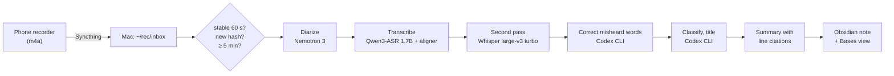

# rec2vault

**Record a meeting with your Android phone's built-in recorder. A few minutes later, a speaker-labeled
Korean meeting note appears in your Obsidian vault — transcribed on your own Mac.**

[한국어 README](README.ko.md) · [Visual overview (Korean, open locally)](docs/overview.html) · [Benchmark](docs/benchmark.md)

Dedicated AI recorders such as Plaud pair a hardware recorder with cloud transcription and a monthly
minute quota. An Android phone already records well, and an Apple Silicon Mac can run speech models
locally, so this project fills the same four steps with hardware you probably already have:

| Step | Plaud | This project |
|---|---|---|
| Record | dedicated recorder | the phone's built-in recorder app, unchanged |
| Move | vendor app | Syncthing, automatic on save |
| AI processing | vendor cloud, minute quota | your Mac: local diarization + transcription, no quota |
| Result | vendor app | Markdown notes in your Obsidian vault |

## What you get

- Hands-off: after you stop and save a recording, nothing else to do. A launchd job checks for new
  files every minute, retries failures and never processes the same audio twice.
- Speaker diarization and Korean transcription run locally (MLX). **The audio never leaves your
  devices.**
- A subscription CLI you already pay for (Codex CLI, with an optional Gemini-based fallback) fixes
  misheard words, classifies the meeting, writes a title and a summary in a layout that fits the
  meeting type (meeting, status update, presentation, lecture, 1:1, brainstorming).
- Every summary sentence links to the transcript line it came from (`[[#^t012|02:20]]`), so claims can
  be checked against what was said.
- Notes are named `YYYY-MM-DD_<title>_<HHMM>.md` and carry properties (date, start time, length,
  type, topics, speakers, original file name and hash) for sorting and filtering with Obsidian Bases.
  A `회의록.base` view is created next to the notes.

Measured on a Mac mini M4 (16 GB): a 35-minute recording becomes a note in about 13.5 minutes. Local
transcription is about as far from two commercial Korean services as they are from each other
(see [docs/benchmark.md](docs/benchmark.md)).

## How it works

**Step by step, with the real intermediate output of one fictional meeting: [docs/how-it-works.md](docs/how-it-works.md).**



Each stage writes its result to `~/rec/work/<job_id>/`, so an interrupted or failed job resumes at
the failed stage (up to 3 attempts, 5 minutes apart). Job state lives in SQLite (`~/rec/state.sqlite3`).
Only the text transcript is sent to the CLI; prompts treat the transcript as data and never ask the
model to run tools.

## Requirements

- Apple Silicon Mac that stays on (tested: Mac mini M4, 16 GB; peak memory ~5 GB), macOS, logged in
  (launchd user agents stop at the login screen; enable automatic login for unattended use).
- [Homebrew](https://brew.sh) with `uv` and `ffmpeg`: `brew install uv ffmpeg`.
- [Syncthing](https://syncthing.net) on the Mac and [Syncthing-Fork](https://github.com/Catfriend1/syncthing-android)
  on the phone.
- [Codex CLI](https://github.com/openai/codex), logged in with `codex login` (a ChatGPT plan works).
  Optional fallback: Antigravity CLI (`agy`).
- About 5.2 GB of disk for the models (downloaded once by the installer).
- Tested with a Samsung Galaxy S25 Ultra (`Recordings/Voice Recorder`). Any phone that writes `.m4a`
  files to a folder Syncthing can share should work.

## Setup

**1. Install on the Mac** (or on another Mac over SSH with `HOST=<ssh-host>`):

```sh
git clone https://github.com/minigold92/rec2vault.git && cd rec2vault
REC_OUTPUT="$HOME/Obsidian/MyVault/Meetings" deploy/install.sh
```

The installer copies the app to `~/rec/app`, installs dependencies, runs the tests, downloads the
models, writes `~/rec/settings.env` on first run and loads the launchd agent `local.rec.pipeline`.
Re-run it to update; settings are kept.

**2. Connect the phone.**

1. Pair the phone and the Mac in Syncthing.
2. On the phone, in Syncthing-Fork, add the folder `Recordings/Voice Recorder`, type **Send Only**,
   shared with the Mac. Exempt the app from battery optimization.
3. On the Mac, accept the share with folder path `~/rec/inbox` and type **Receive Only**.

Existing recordings will also sync but are skipped: only recordings made after `REC_SINCE` (set to
the install time) are processed. To avoid copying them at all, add their names to the folder's
ignore patterns on the Mac before accepting the share.

> Syncthing-Fork 2.1.3 quirk: if the save (✓) button stays grey after choosing a folder, rotate the
> phone to landscape and back; the button becomes active.

**3. Log in to the CLI**: `codex login` on the Mac.

**4. Try it**: record five minutes or more and save. Watch `~/rec/logs/pipeline.log`; the note
appears in `REC_OUTPUT`.

## Configuration

`~/rec/settings.env` (KEY=VALUE, read on every run; environment variables take precedence):

| Key | Default | Meaning |
|---|---|---|
| `REC_OUTPUT` | `~/rec/notes` | Folder for notes, ideally inside your Obsidian vault |
| `REC_SINCE` | install time | Skip recordings made before this local time (`YYYY-MM-DD HH:MM`) |
| `REC_MIN_DURATION_SEC` | `300` | Skip shorter recordings |
| `REC_STABLE_SEC` | `60` | A file must stay unchanged this long before processing |
| `REC_CODEX_EFFORT` | `low` | Codex reasoning effort for pipeline calls |
| `REC_AGY_MODEL` | `gemini-4-argon-medium` | Model for the `agy` fallback |

Install-time only: `REC_LABEL` (launchd label, default `local.rec.pipeline`).

Process a recording from before `REC_SINCE`:

```sh
cd ~/rec/app && .venv/bin/python -m rec.backfill "음성 261106_142617.m4a"
```

This adds the name to `~/rec/include.txt` and removes it from the inbox folder's Syncthing ignore
patterns; the next run handles it like a new recording. Call recordings (`통화*`) are never processed.

## Data and privacy

- Audio files stay on your phone and your Mac. Transcription and diarization run locally; models are
  downloaded once and the pipeline runs with `HF_HUB_OFFLINE=1`.
- The **text** transcript is sent to the CLI's provider (OpenAI for Codex, Google for `agy`) for
  correction and summarization, under your account's data settings.
- Recording other people requires their consent. Work meetings may also require your organization's
  approval before transcripts go to an external AI service.

## Limitations

- Korean only: the ASR language, prompts and note properties are Korean.
- macOS on Apple Silicon only (MLX).
- Many-speaker meetings (5+) diarize noticeably worse (speaker agreement ~0.78 in the benchmark).
- Summary quality has not been evaluated against human-written minutes.
- If the Codex login expires and `agy` is not installed, jobs fail after 3 attempts; the transcript
  stages are kept, so re-queuing resumes at the summary.

## Development

```sh
uv run --no-project --with pytest python -m pytest -q tests
```

| Path | Role |
|---|---|
| `rec/tick.py` | One pass: scan the inbox, then process queued jobs stage by stage |
| `rec/intake.py` | Stability check, validation, dedupe by SHA-256, archive, enqueue |
| `rec/models.py` | Local model stages, each in its own process (`diarize`, `asr`, `alt`, `prefetch`) |
| `rec/transcript.py` | Word → speaker-turn alignment |
| `rec/postprocess.py`, `rec/llm.py` | Correction, classification, summary through the CLIs |
| `rec/render.py` | Obsidian note, properties, citation links, Bases view |
| `rec/syncthing.py`, `rec/backfill.py` | Syncthing REST calls, processing older recordings |
| `deploy/` | Installer, setup script, launchd template |

## Related projects

Pieces of this pipeline exist elsewhere; as far as a search on 2026-11-09 found, not this combination
(Android built-in recorder → Syncthing → local Korean ASR and diarization on MLX → subscription-CLI
summary → Obsidian note with line-level citation links). Worth a look:

- [silverstein/minutes](https://github.com/silverstein/minutes): local-first conversation memory; phone
  folder sync, pyannote-rs diarization, summaries through `claude`/`codex` CLIs, Markdown output.
- [sjoon21/Tractus](https://github.com/sjoon21/Tractus): Mac app with MLX Qwen3-ASR (Korean/English),
  speaker detection and timestamp links, export to Obsidian.
- [mindrepublic2018/plaud-obsidian-pipeline](https://github.com/mindrepublic2018/plaud-obsidian-pipeline):
  Plaud recordings → Korean/English minutes in Obsidian.
- [libaoming/meet-scribe](https://github.com/libaoming/meet-scribe): launchd watch folder → WhisperX +
  pyannote → `claude -p` → Obsidian.
- [fryktik99/local-first-daily-assistant](https://github.com/fryktik99/local-first-daily-assistant):
  Syncthing inbox with a file-stability barrier and SQLite state.
- [surfnterd/syncthing-partial-recordings](https://github.com/surfnterd/syncthing-partial-recordings):
  why a watcher must never move or delete files in a Syncthing inbox (partial m4a files, deletions
  propagating back to the phone). This pipeline only reads the inbox and copies stable files out.

Samsung and Galaxy are trademarks of Samsung Electronics; Plaud is a trademark of its owner. This
project is not affiliated with either.

## License

MIT for this code. Models keep their own licenses: Qwen3-ASR and Qwen3-ForcedAligner (Apache-2.0),
NVIDIA Nemotron 3 Diarization (OpenMDW-1.1), Whisper (MIT).
