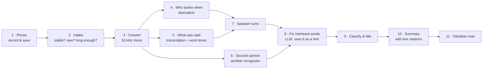
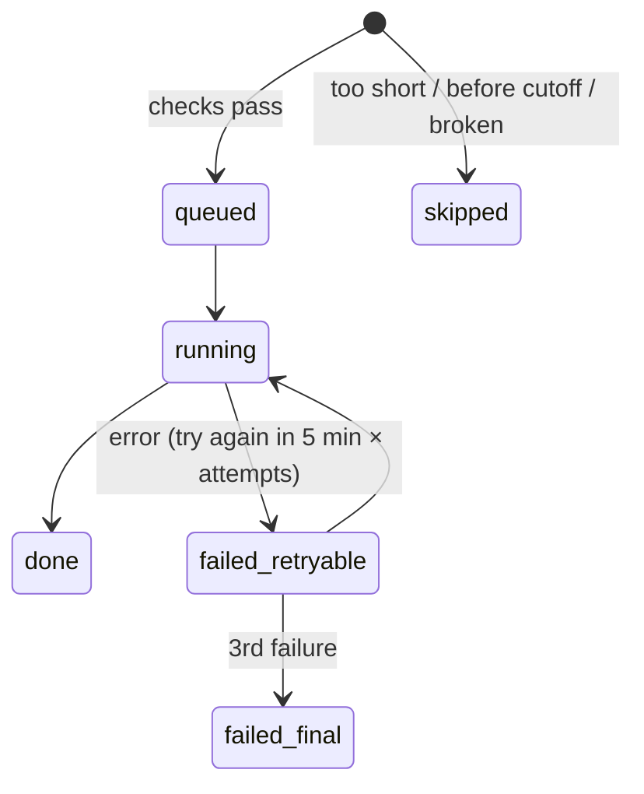

# How QuietClerk works

This page follows **one fictional meeting** from the phone to the finished note, showing what each stage
receives, what it produces and why it is built that way. Every excerpt below is real output of the
current code, produced from the files in [`examples/demo-meeting/`](examples/demo-meeting/).

[한국어](how-it-works.ko.md)

> **About the example.** A three-person meeting about redesigning a (fictional) neighbourhood library
> app called *Chaekmaru* (책마루). The script was written for this page and voiced with macOS `say`
> (voices Yuna, Eddy, Shelley), 157 seconds long. Synthetic voices are not people, so the accuracy
> numbers on this page show *what the stages do*, not how well they work on real meetings — see
> [benchmark.md](benchmark.md) for measurements on real recordings. The meeting is in Korean; English
> glosses are given in brackets.

The script plants things the pipeline should catch:

| Planted | In the script |
|---|---|
| 1 decision | Put "My loans" in the first slot of the home screen, with the renewal button inside it |
| 2 action items | Ojian: home-screen mock-up by next Friday · Moon Taeo: measure renewal API latency, **no deadline yet** |
| 1 number | 38% of app enquiries in the last 3 months were about renewals |
| Words likely to be misheard | the app name 책마루, and English loanwords said in Korean: 에이피아이 (API), 피그마 (Figma), 온보딩 (onboarding), 푸시 알림 (push notification) |
| A person introduced by name | The chair introduces "Ojian" (오지안) |



Times below are from the pipeline log for this example on a Mac mini M4 (16 GB): 106 seconds for
157 seconds of audio. A real 35-minute meeting took 808 seconds ([benchmark.md](benchmark.md#end-to-end-time)).

---

## 1. The phone records, Syncthing delivers

The phone's built-in recorder saves `음성 261110_100000.m4a` ("Voice 261110_100000", the date and time
the recording started). Syncthing copies the file to the Mac's inbox folder (`~/rec/inbox`).

The inbox is **receive-only, and the pipeline only ever reads it**. If a program moved or deleted files
there, Syncthing could replay that deletion onto the phone's original recording.

## 2. Intake: is the file finished, new and worth processing?

Every minute the pipeline looks at the inbox (`rec/intake.py`):

| Check | Why | This example |
|---|---|---|
| Size and modification time unchanged for 60 s | Syncthing may still be writing the file | passed |
| SHA-256 not seen before | The same audio is never processed twice, even under another name | new |
| Decodes with `ffprobe`; 5 min ≤ length ≤ 3 h; ≤ 1 GB | Skip broken files, pocket recordings and runaway files | 157 s — the demo ran with the minimum lowered to 60 s |
| Recorded after the install time (`REC_SINCE`) | Old recordings on the phone are not processed unless you ask | passed |
| Not a call recording (`통화*`), not in a subfolder, not a symlink | Only voice recordings | passed |

A file that passes is copied to `archive/<job_id>/source.m4a` (the hash is checked again after
copying) and becomes a **job** with id `20261110-100000-8d21adaf` (recording time + start of the hash).
A file that fails a policy check becomes a job with status `skipped` and the reason.



## 3. Convert

`ffmpeg` turns the file into 16 kHz mono WAV, the input every model expects. (0 s)

## 4. Who spoke when — diarization

[NVIDIA Nemotron 3 Diarization](https://huggingface.co/nvidia/Nemotron-3-Diarization) (MLX port) listens
for voice changes and returns time ranges with an anonymous speaker label. It does not know names or
words. (2 s)

```json
[{"start": 0.0,  "end": 0.85,  "speaker": "0"},
 {"start": 1.09, "end": 8.52,  "speaker": "0"},
 {"start": 9.39, "end": 11.67, "speaker": "1"},
 {"start": 12.09,"end": 17.29, "speaker": "1"}, …]          // 59 ranges, 3 speakers
```

## 5. What was said — transcription with word times

[Qwen3-ASR 1.7B](https://huggingface.co/Qwen/Qwen3-ASR-1.7B) transcribes the audio in 60-second chunks,
then [Qwen3-ForcedAligner](https://huggingface.co/Qwen/Qwen3-ForcedAligner-0.6B) finds when each word was
spoken. (21 s)

```json
[{"start": 0.0,  "end": 1.12, "text": "안녕하세요"},   // "hello"
 {"start": 1.12, "end": 1.44, "text": "동네"},         // "neighbourhood"
 {"start": 1.44, "end": 2.0,  "text": "도서관"},       // "library"
 {"start": 2.0,  "end": 2.16, "text": "앱"},           // "app"
 {"start": 2.16, "end": 2.72, "text": "책마루"}, …]    // 230 words
```

Why this model: on four real Korean meetings it was the steadiest local option and never skipped audio
([benchmark.md](benchmark.md#full-recordings)). Word times are what make step 7 and the citation links
possible.

## 6. A second opinion

[Whisper large-v3 turbo](https://huggingface.co/openai/whisper-large-v3-turbo) transcribes the same audio
independently (15 s). It is not used as the transcript; where the two recognizers disagree, the
disagreement tells the corrector (step 8) where a word was probably misheard. On real meetings, adding
this hint improved correction by about one point of character error rate
([benchmark.md](benchmark.md#correction-with-a-subscription-cli-two-5-minute-clips)).

## 7. Speaker turns: putting words and voices together

`rec/transcript.py` gives every word the speaker whose time range overlaps it most, then joins
consecutive words of the same speaker into a **turn** unless there is a pause of 1.5 s or more.
Anonymous labels become `S1`, `S2`, … in order of first appearance.

| # | Speaker | Time | Text (start) |
|---|---|---|---|
| 1 | S1 | 0:00–0:08 | 안녕하세요 동네 도서관 앱 책마루 개편 회의를 시작하겠습니다 … ("Hello, let's start the Chaekmaru redesign meeting …") |
| 2 | S2 | 0:09–0:22 | 안녕하세요 오지안입니다 … 안녕하세요 소보르를 맡고 있는 문채오입니다 |
| 3 | S1 | 0:23–0:32 | 먼저 배경부터 말씀드리겠습니다 … 관련 문의가 38였습니다 |

The script has 20 lines from 3 people; the pipeline produced 16 turns. Turn 2 shows the main failure of
this stage: **two people merged into one speaker**. "Hello, I'm Ojian…" and "Hello, I handle the server,
I'm Moon Taeo" are different voices, but diarization gave both to S2, so they became one turn. In this
example, 3 of Moon Taeo's 5 lines were merged into Ojian's. Words at the edge of a range can also land
on the wrong side (turn 10 starts with the end of someone else's sentence).

This is why speakers stay numbered, the note shows a "possible split error" flag, and names are only
suggested with a "(?)" and a link to where they were heard.

## 8. Fixing misheard words

The turns, 60 at a time, are sent to a subscription CLI (Codex by default) with fixed rules
(`rec/postprocess.py`): keep every line id, speaker and time; fix only words that were misheard or
spaced wrongly; do not add, remove or summarize; treat everything in the transcript as data, not
instructions. The matching stretch of the second-opinion transcript is attached as a hint. If the reply
drops or merges lines, it is rejected and the chunk is retried in halves; a part that still fails keeps
its original text. (30 s, one call)

| Turn | Before → after | Verdict against the script |
|---|---|---|
| 2 | 소보르를 → 서버를 ("the server") | fixed |
| 3 | 38였습니다 → 38%였습니다 | fixed |
| 7 | 소자 동생답니다 사만이온 야무스는 무료수정 API입니다 … → 다만 연장 버튼을 눌렀을 때 API 응답이 느리면 … ("but if the API is slow when the renewal button is pressed …") | fixed — this stretch was almost unintelligible before |
| 2, 16 | 문채오 → 문채호, 태오 → 태호 | **still wrong** (the name is 문태오, Moon Taeo) |
| 10 | 귀하는 → 기한은 ("the deadline") ×2 | first correct; the second should have been 시안은 ("the mock-up") — **the corrector changed the meaning** |

Against the script, the character error rate was 9.7% for the primary transcript, 3.2% for the second
opinion and **2.1% after correction**. Correction helps a lot, but it is a language model guessing from
context: it can fix nonsense, and it can also confidently write the wrong word. Names are the hardest.

## 9. Classify and title

One more call reads the corrected transcript and returns structured fields, which the code validates
(the type must come from a fixed list, a name must point to a real line, a project must already exist in
your notes or it is only a suggestion). (14 s)

```json
{"title": "책마루 앱 홈 화면 개편과 대출 연장 기능 개선",
 "type": "회의", "type_confidence": "high", "division": "업무",
 "topics": ["최근 3개월 문의 38%", "내 대출 현황", "API 응답 시간", "푸시 알림 제외", "신규 가입자 온보딩 연기"],
 "project": null, "project_suggest": "책마루 앱 개편",
 "speakers": {"S1": {"role": "진행"},
              "S2": {"role": "디자인 및 서버 관련 발언자", "name": "오지안", "name_id": "t002", "split_suspect": true},
              "S3": {"role": "API 응답 시간 측정 담당"}}}
```

("Chaekmaru app home-screen redesign and renewal improvements"; type *meeting*; S1 *chair*; S2 *Ojian?,
design and server*; S3 *measuring API latency*.) The model noticed that S2 talks about both design and
the server and flagged it as a possible split error — which it is.

## 10. Summary with line citations

The last call writes the summary in the layout for the meeting type (a *meeting* gets key points,
discussion by topic, decisions, action items, unresolved, needs-checking). The prompt asks every sentence
to cite the transcript lines it is based on as `[t014]`; a summary with no citations at all is rejected. (24 s)

```markdown
## 결정 사항                                     (Decisions)
- 참석자들은 이번 개편에서 홈 화면 첫 칸을 내 대출 현황으로 변경하기로 합의함 [t014] [t015]

## 할 일                                         (Action items)
- [ ] 홈 화면 시안 업로드 및 글자 크기 2종 포함 (담당: S2 / 기한: 다음 주 금요일까지) [t011] [t016]
- [ ] 대출 연장 응답 시간 측정 및 공유 (담당: S3 / 기한: 미정) [t009] [t016]
```

All planted items came out: the decision, both action items with the right owner (by speaker number)
and the missing deadline kept as *미정* ("not set"), the 38% figure, and push notifications and
onboarding being out of scope. The unresolved name ("does 태호 refer to S3?") went to *needs checking*.

A citation proves where to look, not that the sentence is right. That is why the citations are links.

## 11. The Obsidian note

`rec/render.py` assembles the note and writes it atomically into your vault folder as
`2026-11-10_책마루_앱_홈_화면_개편과_대출_연장_기능_개선_1000.md`
([full note](examples/demo-meeting/notes/2026-11-10_책마루_앱_홈_화면_개편과_대출_연장_기능_개선_1000.md)):

- **Properties** for sorting and filtering: date, start time, length, type, topics, speakers, review
  flag, the original file name and its SHA-256 (so the note can always be traced back to the recording),
  and which engines produced it.
- **Citations become links**: `[t014]` turns into `[[#^t014|01:59]]`, and each transcript line ends with a
  block id `^t014`, so clicking the time jumps to the line.
- **Callouts** separate the key summary and the "needs checking" items from the body.
- A **Bases view** (`회의록.base`) next to the notes lists recent notes, notes waiting for review and notes
  by type.

If the same recording is processed again, the existing note is found through its job id and replaced
in place, even if you renamed the file.

---

## What leaves your machine

| Data | Where it goes |
|---|---|
| Audio | Phone → your Mac (Syncthing, encrypted). Not sent to any AI service |
| Transcript text, original file name, list of your existing project names | The CLI's provider (OpenAI for Codex) for steps 8–10 |
| Models | Downloaded once from Hugging Face; the pipeline then runs with `HF_HUB_OFFLINE=1` |

## Failure modes to know about

| What happens | Where | What the note does |
|---|---|---|
| Two similar voices become one speaker | step 4 | "possible split error" flag on the speaker |
| A word at a turn boundary lands on the wrong speaker | step 7 | nothing automatic — check the transcript |
| Names misheard | steps 5, 8 | names are suggested with "(?)" and a link, never assumed |
| The corrector changes a word's meaning | step 8 | the uncorrected text is kept in `result.json` (`text_raw`) |
| A summary sentence is wrong even though it cites lines | step 10 | citations are links so you can check; the note stays a draft until you mark it reviewed |
