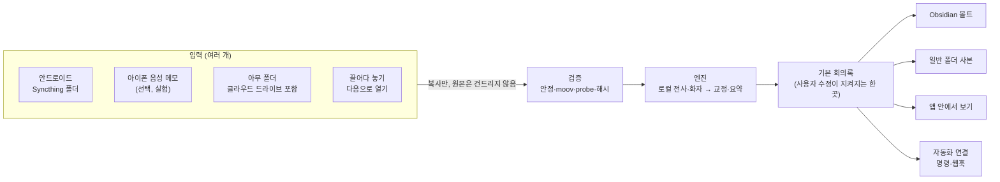
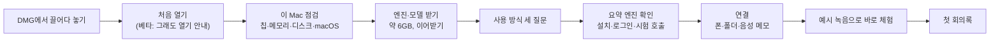

# QuietClerk 앱 배포 설계 v3

작성 2026-11-11. 엔진 계약은 `contracts-v2.md`, 이전 제품 설계는 `product-design-v2.md`를 그대로 따른다. 이 문서는 그 위에 **배포용 Mac 앱**을 얹는 설계다.
근거 조사: `research/app-packaging.md`(앱 묶는 방식·서명·업데이트), `research/input-paths.md`(입력 경로별 가능 여부).

- **목적**: 터미널을 모르는 사람이 내려받아 설치하고, 자기 방식대로 녹음을 넣고, 원하는 곳에서 회의록을 받는다. 관리할 일이 거의 없어야 한다.
- **이 문서로 정하는 것**: 앱 구조, 사람마다 다른 사용 방식을 받는 설정 구조, 첫 실행 흐름, 업데이트·관리, 베타에서 공개까지의 순서.
- **정하지 않는 것**: 엔진 내부(받아쓰기·요약)는 v2 계약 그대로다.

## 1. 정해진 것 (사용자, 2026-11-11)

| 항목 | 결정 |
|---|---|
| 배포 대상 | 베타(지인 몇 명) → 기준을 넘으면 공개 |
| 입력 | 안드로이드 폰 녹음 앱, 아이폰 음성 메모, 폴더·클라우드 드라이브, 파일 끌어다 놓기. **Mac 직접 녹음은 이번 범위 밖** |
| 결과 | Obsidian 볼트, 일반 폴더(Markdown), 앱 안에서만 보기, 사용자 자동화 연결. 여러 개를 동시에 고를 수 있음 |
| 서명 | 베타는 서명·공증 없이, 공개 때 Apple Developer Program(연 99달러) 가입 |
| 질문·정리 | 앱에 넣지 않는다. 읽기 전용 CLI로 omp·Claude·Codex가 하게 한다(`contracts-v2.md` 10.9) |

## 2. 사용 방식을 사람마다 다르게: 입력 → 엔진 → 결과

### 2.1 입력 원천 (`sources`)

설정의 `inbox` 하나를 **원천 목록**으로 바꾼다. 모든 원천은 같은 검증(크기 한도 → 격리 복사 → 안정 → moov·probe → 해시 → 확정)을 거치고, 원본을 옮기거나 지우지 않는다.

| 종류 | 하는 일 | 첫 배포 | 근거·조건 |
|---|---|---|---|
| `folder` | 고른 폴더의 새 녹음(m4a·mp3·wav·aac) | 넣음 | 클라우드 폴더의 내려받기 안 된 파일(`SF_DATALESS`)은 "내려받는 중"으로 두고 따로 읽는다. 스트리밍 폴더는 "항상 이 기기에 유지/미러"를 권함 |
| `syncthing` | `folder` + Syncthing 짝짓기·공유 안내 화면 | 넣음 | 안드로이드에서 앱 설치 없이 "녹음 끝 → 자동 전송"이 되는 길은 조사 범위에서 Syncthing-Fork와 FolderSync 같은 서드파티 폴더 감시 앱뿐이다. 폴더 선택 화면 버그(v2.1.3, 2026-11-09 실제 경험)처럼 사용자 손이 남는다 |
| `drop` | 앱 창·Dock 아이콘에 놓은 파일, Finder "다음으로 열기" | 넣음 | 앱 셸이 있어야 한다(브라우저 화면으로는 경로를 못 받음) |
| `voice_memos` | 아이폰 음성 메모가 iCloud로 Mac에 오면 자동 처리 | **선택 기능(실험)** | 전체 디스크 접근(FDA)이 필요하고 Apple이 공개하지 않은 위치·DB다. 파일 폴더만 감시하고 제목은 DB가 읽히면 쓴다. 권한이 없으면 "음성 메모 앱에서 끌어다 놓기"를 안내한다 |

원천마다 이름·켜기/끄기·"이 시각 이전 녹음은 건너뜀"(지금의 `since`)을 따로 둔다. 같은 녹음이 두 원천으로 와도 해시로 한 번만 처리한다.

### 2.2 결과 (`outputs`)

회의록 하나에 **기본 위치 하나**가 있고, 나머지는 사본이다.

| 종류 | 내용 | 사용자 수정 |
|---|---|---|
| `obsidian` | 지금 형식(속성·근거 링크 `[[#^t12\|00:23]]`·블록 ID·`회의록-v2.base`) | 기본 위치로 고르면 제목·할 일 체크·메모가 지켜진다(v2 7장) |
| `markdown` | 어느 편집기에서도 읽히는 형식. 근거는 `(00:23)` 시각, 블록 ID·Obsidian 콜아웃 없음(지금 내보내기와 같은 변환) | 기본 위치로 고르면 같은 규칙으로 지켜진다 |
| `app` | 파일을 만들지 않고 앱 데이터 폴더에만 둔다. 화면에서 보고 고친다 | 앱 화면에서 고친 것이 지켜진다 |
| 사본 | 기본 위치가 아닌 출력은 매번 새로 쓰는 읽기용 사본 | 사본에서 고친 것은 다음 처리 때 덮인다고 화면에 표시 |

### 2.3 자동화 연결 (`hooks`)

회의록이 게시되거나 작업이 실패하면 사용자가 지정한 것을 실행한다. 노션·슬랙·캘린더 같은 연동은 앱에 넣지 않고 이 연결과 CLI로 사용자가 붙인다. 레시피는 문서로 제공한다.

| 종류 | 동작 | 보내는 것 |
|---|---|---|
| `command` | 실행 파일과 인자를 직접 실행(셸 없음), 제한 시간, 표준 입력으로 JSON | 기본: job_id·제목·날짜·파일 경로·상태. 대화록·요약 본문은 사용자가 항목별로 켤 때만 |
| `webhook` | HTTPS POST(로컬 주소 포함), 서명 헤더(공유 비밀) | 같은 규칙. 밖으로 나가는 전송이라 엔진 동의(8장)와 같은 화면에서 켠다 |

실패해도 회의록은 그대로다. 실행 기록(시각·종료 코드·소요 시간)만 남기고 출력 내용은 저장하지 않는다.

### 2.4 처음 고를 때 묻는 것

설정 항목을 다 보여 주지 않는다. 첫 실행에서 세 가지만 묻고 원천·결과를 채운다. 나중에 설정 화면에서 바꾼다.

1. 녹음은 어디서 하나요? → 안드로이드 / 아이폰 / 파일로 가지고 있어요(여러 개)
2. 회의록은 어디서 보나요? → Obsidian / 그냥 폴더 / 이 앱에서
3. 요약은 무엇으로 하나요? → Codex / Claude Code / 내 Mac에서만(로컬, 실험) — 설치·로그인 상태를 감지해 보여 준다

## 3. 앱 구조

조사(`research/app-packaging.md` 7절) 추천을 따른다. 2026-11-11에 비슷한 로컬 회의록·받아쓰기 앱 14개 저장소를 확인했다: Tauri 7개(meetily 32.6k, anarlog 9.9k, vibe 8.1k, humla, oats, perchnote, Tractus), Electron 1개(OpenWhispr), Swift 전용 4개(모두 별 1k 미만), 파이썬 GUI 1개(Buzz). humla·perchnote는 Tauri에 Swift를 섞는다. 14개 모두 코드가 공개돼 있다.

| 부분 | 선택 | 이유 |
|---|---|---|
| 앱 셸 | **Tauri v2 + 얇은 Rust OS 연결**: 메뉴 막대 아이콘 + 창(지금 웹 화면을 그대로 띄움). S1에서 Swift/SMAppService 헬퍼는 0.0.x에 쓰지 않기로 함 | 화면은 엔진이 서빙한다. 서비스 변경은 Python 설치기 명령을 호출해 로직·언어를 중복하지 않는다. Developer ID 서명 후 A 재평가는 앱 계약 6절 |
| 엔진 설치 | 앱 안에 서명된 `uv`·최소 LGPL FFmpeg/ffprobe와 엔진 wheel·해시 고정 의존성 목록을 넣고, 첫 실행에 기존 설치기의 `~/QuietClerk/.venvs/<id>/`에 설치한다 | A1은 기존 rollback 설치 경로·데이터 위치를 재사용한다. 모델은 설치 중 모델별 진행을 보이며 받고 HF 캐시를 재사용한다. 번들 안 Python은 없으므로 JIT 서명 예외도 필요 없다 |
| 상주 | 엔진은 로그인 시 자동 시작하는 기존 launchd 에이전트(`local.quietclerk.serve`). **venv Python을 직접 실행**하므로 창·앱 종료, 앱 업데이트·이동에도 처리는 계속 | S1 실제 launchd로 등록·인증·앱 종료 후 유지·kill 재시작·번들 교체·이동·CLI 공존·해제 확인. ad-hoc SMAppService는 cdhash 실행 제약 실패, 앱 런처 방식은 이동 시 실패하여 제외. 로그인 재부팅 자체는 미확인 |
| 모델 | 첫 실행에 받는다(약 5.2GB). 이어받기, 크기·해시 확인, 앱 업데이트로는 건드리지 않음 | — |
| 앱 업데이트 | Tauri updater, **공개 저장소 `rec2vault`의 GitHub Releases**(`latest.json`, 베타·안정 두 채널). 엔진은 잠금 해시가 바뀔 때만 새 폴더에 만들고, 성공하면 바꿔 끼운다. 이전 엔진 1개 보존 | 비공개 저장소의 Release 파일은 로그인해야 받을 수 있어 앱에 토큰을 넣어야 한다. 그래서 공개한다(사용자 결정 2026-11-11). git 체크아웃 기반 업데이트는 개발자·Mac mini 설치용으로 남긴다 |
| 데이터 위치 | 앱과 데이터를 나눈다: 앱 `/Applications/QuietClerk.app`, 데이터 `~/Library/Application Support/QuietClerk/`(DB·엔진·모델·로그·`app` 출력), 사용자 파일은 사용자가 고른 곳 | 앱을 바꿔도 데이터는 그대로 |
| 권한 | 기본 흐름에 마이크·화면·FDA 요구 없음. 폴더는 열기 창으로 고르게 한다. FDA는 `voice_memos`를 켤 때만 | 사용자가 고른 폴더는 의도 기반 접근이라 권한 팝업 대상이 아니다(조사 5.4) |
| 배포 | DMG 직접 배포. Mac App Store는 안 맞는다(외부 CLI 실행·상주·첫 실행 내려받기가 심사 규칙 2.4.5와 충돌) | — |

### 3.1 메뉴 막대

| 항목 | 내용 |
|---|---|
| 상태 | 맥서기 아이콘. 처리 중·오류·일시정지가 아이콘으로 보인다 |
| 메뉴 | 지금 처리 중(단계·경과) · 최근 회의록 3개 · 녹음 파일 넣기 · 일시정지 · QuietClerk 열기 · 업데이트(있을 때) · 종료 |
| 알림 | 회의록 완료(끌 수 있음), 실패·막힘(로그인 만료, 디스크 부족) |

## 4. 첫 실행 흐름

- **받는 동안 할 일을 준다**: 엔진·모델을 받는 동안(수십 분일 수 있음) 세 질문과 연결 안내를 먼저 진행한다.
- **예시 녹음으로 체험**: 앱에 든 가상 회의 녹음(지금 `docs/examples`의 한국어·영어 데모)을 처리해, 녹음하기 전에 결과를 본다.
- 막히면 그 단계에 이유와 해결 버튼을 보여 준다. "나중에 하기"로 넘길 수 있고 홈에 남은 할 일로 남는다.

## 5. 관리

| 일 | 방법 |
|---|---|
| 업데이트 | 메뉴 막대·화면 위 띠에서 한 번 누름. 처리 중이면 끝난 뒤. 실패하면 이전 버전 |
| 문제 신고 | 설정 > "진단 묶음 만들기": 상태·설정·로그를 묶되 회의 제목·파일 이름·대화 내용·경로의 사용자 이름은 지운다. 사용자가 확인하고 보낸다 |
| 데이터 위치 | 설정 한 화면에 원천·결과·데이터 폴더·용량. "Finder에서 보기" |
| 정리 | 변환 음성 보존 기간(지금 `retention.wav_days`), 오래된 엔진·모델 정리 |
| 지우기 | 설정 > "QuietClerk 지우기": 서비스 등록 해제 → 앱 데이터 지울지 선택(회의록 파일은 지우지 않음) → 앱을 휴지통으로 |
| 여러 Mac | 한 Mac이 처리하고 다른 Mac·폰은 볼트 동기화로 본다(지금 구조). 화면은 `open_remote` 방식 유지 |

## 6. 입력 유형별 처리 방침과 비정상·악의 입력 시험

방침은 `research/input-paths.md` 6절과 `research/app-packaging.md` 8절을 합친 것이다. 각 경로는 아래 시험이 "실제 입력으로 확인"까지 통과해야 화면에 "지원"으로 표시한다.

| 입력 | 방침 | 비정상·악의 시험 |
|---|---|---|
| 녹음 파일(모든 원천) | 복사 후 검증, 원본 이동·삭제 금지. moov 없음·디코딩 실패는 대기(파일이 바뀌면 다시 확인), 위장 컨테이너는 probe가 허용 형식만 엶 | moov 없는 m4a, 0바이트·확장자만 m4a, 재생 목록·HLS 위장, 아주 큰 파일·디스크 부족, `-`로 시작·줄바꿈·NFD 이름 |
| 클라우드 폴더 | `SF_DATALESS`면 "내려받는 중", 시간 제한 읽기·재시도, 다른 스레드에서만 | iCloud "다운로드 제거"한 파일, Drive 스트리밍, 네트워크 끊김 |
| 폴더·끌어놓기 경로 | 폴더는 재귀하지 않음, 심볼릭 링크·별칭은 따라가지 않음 | 밖을 가리키는 링크, `..`, 네트워크 볼륨 |
| 같은 녹음 중복 | 해시로 한 번만 | Syncthing·음성 메모·끌어놓기로 같은 파일 3번 |
| 음성 메모(FDA) | 권한이 없으면 안내만, 반복 알림 억제 | 권한 거부·중간 회수, 동기화 덜 된 녹음, 메타데이터에 지시문 |
| 자동화 연결 | 셸 없이 실행, 제한 시간, 출력 저장 안 함, 웹훅은 HTTPS(로컬 예외), 보내는 항목은 동의한 것만 | 무한 대기 명령, 거대한 출력, 리다이렉트, 실패 반복 |
| 업데이트 | 서명 검증을 통과한 것만, 낮은 버전 무시, 잠금 해시 일치한 패키지만 설치 | 서명 불일치, 잘린 파일, 같은 버전 재업로드 wheel, 설치 중 전원 차단 |
| 화면 주소 | 셸은 `127.0.0.1` 고정 오리진만, 외부 이동 차단, 셸 권한은 원격 화면에 안 줌 | 포트 충돌, 다른 오리진 이동, 앱 종료 후 엔진만 살아 있을 때 재연결 |

## 7. 작업 순서

| 단계 | ID | 작업 | 완료 기준 | 담당 |
|---|---|---|---|---|
| 준비 | D0 | 개발 기반: 저장소 재구성(10.7), 저장소 `AGENTS.md`, Rust·Tauri 도구, CI에 macOS 작업 추가, 릴리스 워크플로(빌드 → 서명 → `latest.json`) | **완료 2026-11-11**: 공개 `v0.0.1`·`v0.0.2`, 사용자 MacBook에서 앱 업데이트 0.0.1 → 0.0.2 확인(`acceptance-v2.md`) | impl |
| 스파이크 | S1 | 앱/CLI 공통 launchd 서비스 등록·해제, 창·앱 종료 후 엔진 유지; ad-hoc 두 후보 비교 | **실제 세션 생명주기 확인 2026-11-11**: Python 직접 실행 선택, 앱 교체·이동·CLI 공존·해제 실측(`contracts-app.md` 6절). 실제 재로그인·새 계정 시험은 미확인 | impl |
| | S2 | 에이전트 아래 파이썬이 열기 창으로 고른 폴더를 권한 팝업 없이 읽는지, FDA를 누구에게 줘야 하는지 | 실제 폴더·실제 음성 메모로 확인 | impl + user(아이폰 녹음 1건) |
| | S3 | 깨끗한 macOS 계정에서 첫 실행 엔진 설치(uv)·모델 받기·이어받기 | 새 계정에서 첫 회의록, 걸린 시간 기록 | impl |
| 엔진 | E1 | 원천 목록(`sources`)과 이행(`inbox` → 원천 1개), 클라우드 파일 처리 | 6장 녹음·클라우드·경로 시험 | impl |
| | E2 | 결과 목록(`outputs`): 기본 위치 + 사본, `markdown`·`app` 형식 | 기본 위치에서 사용자 수정 보존, 사본은 덮임 표시 | impl |
| | E3 | 자동화 연결(`hooks`) | 6장 자동화 시험, 노션 레시피 1개 실제 동작 | impl |
| | E4 | 음성 메모 원천(선택 기능) | S2 결과대로. 실제 아이폰 녹음 5건 | impl + user |
| 앱 | A1 | 엔진 wheel·고정 의존성·서명 대상 uv/FFmpeg, 첫 설치·진행·재시도·상태 메뉴, 앱 소유 엔진 업데이트 | **0.0.3 구현**: 공통 Rust 진입점의 실제 설치·서비스·인증·업데이트 검수는 `acceptance-v2.md`. 동의 버튼의 실제 클릭은 사용자 확인 항목. 끌어놓기·다음으로 열기·알림은 이 A1 설치 변경에 포함하지 않음 | impl |
| | A2 | 첫 실행 흐름(4장)과 세 질문 | 비개발자 1명이 도움 없이 예시 녹음 회의록까지 | designer/frontend |
| | A3 | 업데이트(앱·엔진), 진단 묶음, 지우기 | 업데이트·실패 되돌림·지우기 후 데이터 처리 | impl |
| 베타 | B0 | Mac mini(운영 장비)를 베타 채널로 먼저 바꿔 실제 회의로 1~3일 사용 | 실제 회의 처리, 알림 0건(10.3 단계 6) | main |
| | B1 | **공개 0.0.x 릴리스**(서명 없음, ad-hoc) + "그래도 열기" 안내. 따로 비공개 베타를 두지 않고 0.0.x 번호로 초기 단계임을 알린다(사용자 결정 2026-11-11). 지인 몇 명에게 직접 권함 | 사용자별 설치 시간·막힌 곳·도움 요청 횟수 기록 | main + user |
| | B2 | 베타 피드백 반영, 안드로이드 동반 앱 필요 여부 결정(v2 4.2) | Syncthing 단계에서 포기한 비율로 판단 | main + user |
| 공개 | P1 | Developer ID 서명·공증, 안정 채널 첫 릴리스 | Gatekeeper 경고 없음, 베타에서 안정으로 업데이트 동작 | user(계정) + impl |
| | P2 | 공개 시험(v2 2.1 일반 사용자 기준) | 비개발자 도움 없이 통과 | main |

S1–S3는 앱 구조가 실제로 되는지 가르는 시험이라 먼저 한다. 결과가 나쁘면 3장 선택을 바꾼다(대안: 셸만 네이티브 SwiftUI, 엔진은 같은 방식).

## 8. 사용자가 정할 것

| 항목 | 선택지 | 제안·기한 |
|---|---|---|
| ~~베타 업데이트 받는 곳~~ | **정함(2026-11-11)**: `rec2vault` 공개 + GitHub Releases. 초기는 `v0.0.x`로 바로 공개한다. 새 릴리스는 GitHub "pre-release"(베타 채널)로 먼저 올려 Mac mini가 1~3일 쓰고, 문제가 없으면 같은 빌드를 정식(latest)으로 바꾼다 | — |
| 베타 사용자 | 몇 명, 안드로이드·아이폰 비율, 개발자 아닌 사람 포함 | 안드로이드 2, 아이폰 1, 비개발자 2명 이상. B1 전 |
| Apple 계정 | 개인(법적 이름이 판매자로 표시) / 조직(D-U-N-S·웹사이트 필요) | P1 전 |
| ~~앱 식별자~~ | **정함(2026-11-11)**: `io.github.minigold92.quietclerk`. 권한·로그인 항목·업데이트가 여기에 묶이므로 바꾸지 않는다 | — |

## 9. 위험

- 안드로이드 자동 전송은 서드파티 앱(Syncthing-Fork)에 기댄다. 그 앱의 변경·버그가 곧 우리 장애가 된다. 베타에서 포기율이 높으면 동반 앱이 공개의 선행 조건이 된다.
- 아이폰 음성 메모는 Apple이 공개하지 않은 위치·DB다. macOS가 바뀌면 깨질 수 있어 "실험"으로 둔다.
- 첫 실행 때 6GB 내려받기가 실패·중단되면 첫인상이 나쁘다. 이어받기와 남은 크기 표시, 실패 시 다시 시도가 필요하다.
- [추정] 서명 없는 베타는 업데이트 때 macOS가 다른 앱으로 보고 권한(FDA)을 다시 요구할 수 있다. 확인: S2에서 ad-hoc 서명 앱을 다시 빌드해 권한 유지 여부를 본다(담당 impl).
- 녹음 사실 고지: 사용자가 대화 당사자일 때만 쓰라는 안내를 첫 실행과 도움말에 둔다. 개인정보 보호법·회사 규정은 법률 검토 전 단정하지 않는다.

## 10. 개발·검수·유지보수

이 제품은 사용자가 코딩하지 않고, 메인 세션(에이전트)이 구현 에이전트에게 맡겨 만들고 고친다. 에이전트는 세션이 바뀌면 대화를 기억하지 못한다. 그래서 **저장소 안의 문서와 시험이 곧 기억**이 되도록 짠다.

### 10.1 유지보수를 쉽게 하는 구조 원칙

| 원칙 | 내용 | 이유 |
|---|---|---|
| 로직은 엔진에, 셸은 OS 연결만 | Rust 셸은 창·메뉴 막대·알림·끌어놓기·업데이트·엔진 설치 진행 표시만. S1 서비스 변경은 Python 설치기 호출로 단일화한다. Swift 헬퍼는 현재 없고, P1에서 SMAppService 재평가 때만 검토. 상한: Rust 1,500줄, Swift 300줄 | 엔진(파이썬)은 가짜 공급자로 빠르게 확인된다. Rust·Swift는 OS가 있어야 시험되어 고치기 비싸다 |
| 엔진 하나, 설치 경로 둘 | 일반 사용자: 앱. 개발자·Mac mini 같은 화면 없는 장비: 지금의 `deploy/setup.sh`. 둘 다 같은 `quietclerk serve`, 같은 `settings.toml`, 같은 데이터 위치 규칙 | 한쪽만 고쳐서 다른 쪽이 깨지는 일을 막는다. 시험도 같은 엔진을 본다 |
| 셸과 엔진 사이 약속은 문서 하나 | `docs/contracts-app.md`: 부트스트랩 파일, 상태 확인, 셸이 부르는 명령, **셸이 요구하는 최소 엔진 버전**. 바꿀 때 이 문서를 먼저 고친다 | 셸과 엔진은 따로 업데이트될 수 있다. 약속이 흩어지면 업데이트 뒤 조용히 깨진다 |
| 확장 지점은 등록표 | 입력 원천·결과·자동화 연결·요약 공급자는 각각 등록표(이름 → 어댑터)로 둔다. 새 종류는 어댑터 하나 + 공통 시험 묶음 통과 | 기능을 더할 때 기존 코드를 덜 건드린다. 6장의 악의 입력 시험을 모든 원천이 같이 통과한다 |
| 문자열은 한국어·영어 함께 | 화면 문구는 지금처럼 `L('한국어', 'English')`. 한쪽만 있으면 시험이 실패 | 나중에 영어 사용자를 위해 따로 손보는 일을 없앤다 |

### 10.2 개발 흐름

- **누가 무엇을**: 메인 세션이 설계·계약·병합·검수 판단. 범위가 정해진 구현은 `implementer`, 설치·업데이트·DB·동시성은 `implementer-deep`, 화면은 `frontend`. 같은 파일은 한 에이전트만 고친다.
- **독립 리뷰가 필요한 변경**: 설치·업데이트·되돌림, DB 구조, 인증·외부 전송, 동시 실행, 여러 모듈에 걸친 변경. 작성자와 다른 모델 계열(`reviewer`·`astra`)이 diff와 완료 기준만 보고 읽는다. 작은 수정·문서는 리뷰를 붙이지 않는다.
- **완료 판정은 실행 결과로**: 에이전트의 "끝났다"가 아니라 메인이 돌린 시험·캡처·실제 경로 기록으로 판정한다. 버그는 고치기 전 실패하는 시험을 먼저 만든다(지금까지 해 온 방식).
- **저장소 `AGENTS.md`**(짧게): 폴더 구조, 시험 명령, 릴리스 절차, 하면 안 되는 것(운영 Mac mini에 직접 복사, 실제 녹음·회의 내용을 공개 저장소에 넣기). 새 세션은 이 파일과 계약 문서부터 읽는다.

### 10.3 검수 단계

| 단계 | 무엇을 | 어디서 | 언제 |
|---|---|---|---|
| 1. 단위·계약 시험 | 엔진 pytest(지금 935개), Rust `cargo test`, Swift `swift test` | GitHub Actions: Linux + macOS(Apple Silicon). 공개 저장소는 표준 러너가 무료다([GitHub 문서](https://docs.github.com/en/billing/concepts/product-billing/github-actions)) | 모든 push |
| 2. 화면 검사 | 한국어·영어, 1280px·390px 캡처, 콘솔 오류 0, 넘침 0 | 이 MacBook, 헤드리스 브라우저 | 화면이 바뀐 변경마다 |
| 3. 가상 회의 E2E | 한국어·영어 가상 회의(`docs/examples`)를 진짜 모델 + 진짜 Codex로 끝까지 | 이 MacBook | 엔진이 바뀐 릴리스마다. MLX 모델(5GB)과 구독 로그인이 있어야 해서 CI에서는 못 한다 |
| 4. 실제 녹음 회귀 | 비공개 실제 녹음 4건, 삼성·CLOVA 전사와 비교한 오류율, 확인 필요 표시 수, 처리 시간을 직전 릴리스와 비교 | 이 MacBook(비공개 자료) | 전사·요약 단계가 바뀐 릴리스마다 |
| 5. 설치·업데이트 시험 | 이 MacBook의 별도 macOS 사용자 계정에서 DMG 설치 → 첫 실행 → 첫 회의록, 직전 버전에서 업데이트, 일부러 깨진 업데이트의 되돌림, 지우기 후 데이터 처리 | 이 MacBook, 시험용 계정 | 모든 릴리스 |
| 6. 운영 사용 | Mac mini를 베타 채널에 두고 실제 회의를 처리. ops 하트비트·알림 확인 | Mac mini | 베타 릴리스 후 1~3일 |
| 7. 사용자 검수 | 베타 사용자 점검표(설치 시간, 막힌 곳, 회의록 품질 느낌), 문제는 진단 묶음을 붙인 GitHub 이슈 | 베타 사용자 | 베타 기간 |

**릴리스 기준**: 베타 채널은 1~5 통과. 안정 채널은 베타에서 6을 거치고 회귀 이슈가 없을 때 같은 빌드를 올린다(다시 빌드하지 않음). 결과는 `docs/acceptance-v2.md`처럼 단계별 검증 수준(실제 입력 / 가정 / 미확인)으로 남긴다.

### 10.4 릴리스와 되돌림

- 버전: `v0.x.y`, 베타는 `v0.x.y-beta.N`. 태그를 밀면 CI가 빌드·서명(공개 후)·`latest.json` 갱신까지 한다. 손으로 올리지 않는다.
- 채널: 설정에서 베타·안정 선택. Mac mini는 항상 베타.
- 되돌림: 앱 업데이트가 실패하면 앱이 이전 상태로 돌아간다(A3). 나쁜 릴리스가 나가면 낮은 버전으로 내리지 않고 고친 버전을 바로 올린다. 엔진은 이전 엔진 폴더로 돌아갈 수 있다.
- 변경 기록: `CHANGELOG.md`(한국어·영어, 사용자에게 보이는 변화만). 업데이트 띠의 "바뀐 내용"이 여기서 나온다.

### 10.5 유지보수 운영

| 일 | 방법 | 주기 |
|---|---|---|
| 외부 변화 감시 | 예약 CI 작업: 의존성 갱신 제안(Dependabot: pip·cargo·Actions), 요약 CLI(Codex·Claude) 새 버전에서 도구 차단 시험, 고정한 모델 리비전 존재 확인 | 매주 |
| macOS 새 버전 | 베타가 나오면 시험용 계정에서 3·5단계 | 큰 업데이트 전 |
| 이슈 처리 | 이슈 → 재현(가상 회의 또는 사용자가 허락한 표본) → 실패하는 시험 → 수정 → 변경 기록 | 상시 |
| 운영 감시 | Mac mini ops 보드·알림(지금 그대로). 베타 사용자 쪽은 원격 수집 없음, 진단 묶음은 사용자가 확인하고 보낼 때만 | 상시 |
| 기록 | 결정은 설계 문서의 "정해진 것"에 날짜와 함께, 운영 절차는 `docs/operations.md` | 결정할 때마다 |

### 10.6 기능을 더할 때 점검표

1. 계약·설계 문서에 입력·출력·실패 방식을 먼저 적는다.
2. 등록표 확장으로 되는지 본다. 안 되면 왜 안 되는지 적는다.
3. 6장 처리 방침과 악의 입력 시험에 새 입력을 넣는다.
4. 화면 문구 한국어·영어, 캡처 2개 언어 × 2개 폭.
5. 10.3에서 해당하는 단계를 고른다(엔진이면 3·4, 설치면 5).
6. README·how-it-works·`CHANGELOG.md`를 같은 커밋에서 고친다.

### 10.7 저장소 재구성 (D0, 2026-11-11 완료)

전에는 비공개 `rec`에서 개발하고 허용 목록만 `rec2vault`에 복사했다. 공개 후 외부 이슈·기여를 받기에는 복사 방식이 번거롭고 빠뜨리기 쉬워서 바꿨다.

| 저장소 | 내용 | 공개 |
|---|---|---|
| `rec2vault` | 엔진·앱·시험·설계와 계약 문서·실제 내용이 없는 조사·가상 회의 예시. **개발은 여기서 직접** | 공개(0.0.1과 함께) |
| `rec`(비공개, 로컬) | 실제 녹음·전사(`samples/`), 실제 회의 내용이 담긴 조사·실험 문서, 운영 문서, 민감 단어 목록과 검사 스크립트 | 비공개 |

- 민감 단어 목록은 그 자체가 민감해서 공개 CI에 둘 수 없다. `rec/scripts/scan_public.sh`가 `rec2vault`의 push 직전(pre-push hook)에 돈다. 심어 둔 단어가 막히는 것을 확인했다.
- `rec2vault`의 커밋 기록 전체(커밋 7개)를 다시 검사했다. 파일 내용은 깨끗하고, 작성자 메일(개인 gmail)은 사용자 결정으로 그대로 둔다.
- 화면 시안의 PNG 캡처(약 20MB)는 공개 저장소에 넣지 않았다.
- 도구(2026-11-11 확인): Rust 1.99.1을 rustup으로 설치했다. Xcode 없이 명령줄 도구만으로 빈 Tauri 앱이 빌드됐고(첫 빌드 89초, `.app` 4MB, ad-hoc 서명) 실행도 됐다. DMG 묶기는 아직 안 해 봤다.
- 서명: 지금 `Apple Development` 인증서만 있다. 0.0.x는 ad-hoc 서명, 공개 정식 출시 때 Developer ID(P1).
