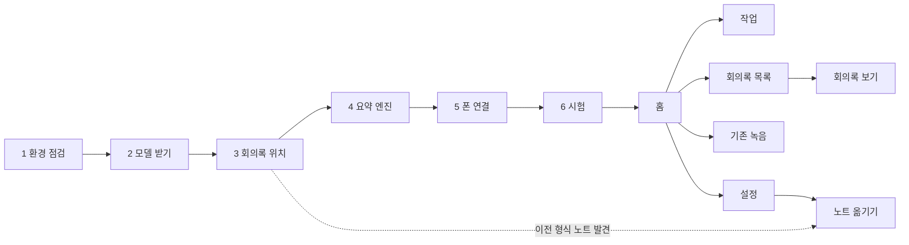

# QuietClerk 로컬 웹 화면 시안 (U1)

작성 2026-11-10. 기준: `docs/product-design-v2.md`(0·3·4·7절), `docs/contracts-v2.md`(2·3.3·5·6·7·8·9절), 말투·색은 사용자 소개 글 `맥서기_v2.html`.

- **이게 뭔가**: 엔진(`quietclerk serve`)이 `127.0.0.1`에서 보여 줄 화면의 정적 시안. HTML·CSS와 작은 JS(`assets/qc.js`, 3KB)뿐이고 프레임워크·외부 CDN·외부 글꼴은 없다.
- **여는 법**: 저장소의 `docs/`에서 `python3 -m http.server 8765 --bind 127.0.0.1` → `http://127.0.0.1:8765/ui/`. 화면마다 주소 뒤에 `?state=empty|error|offline|…`와 `&lang=ko|en`을 붙이거나, 오른쪽 아래 「시안 상태」 상자로 바꾼다. 회의록 보기의 오디오는 저장소에 함께 들어 있는 가상 회의 `docs/examples/demo-meeting/음성 261110_100000.m4a`를 쓴다.
- **캡처**: 화면별 PNG 캡처(138장, 약 20MB)는 저장소 크기 때문에 넣지 않았다. 브라우저로 시안을 열고 `?shot=1`을 붙이면 시안 상자 없이 같은 화면을 다시 찍을 수 있다.

## 1. 화면 목록과 흐름

| 파일 | 화면 | 상태(`?state=`) | 한 화면 한 가지 일 |
|---|---|---|---|
| `wizard-1.html` | 설정 1 · 환경 점검 | normal, empty(점검 중), error(Intel·ffmpeg 없음), offline | 이 Mac에서 돌 수 있나 |
| `wizard-2.html` | 설정 2 · 모델 받기 | normal(받는 중), empty(시작 전), error(끊김→이어받기), disk(공간 부족), offline | 모델 4개 받기 |
| `wizard-3.html` | 설정 3 · 회의록 위치 | normal(볼트 후보), empty(볼트 없음), error(쓰기 권한 없음), offline | 회의록 폴더 고르기 |
| `wizard-4.html` | 설정 4 · 요약 엔진 | normal, empty(찾는 중), error(쓸 엔진 없음), offline | 엔진·순서·보낼 필드·로컬 전용 |
| `wizard-5.html` | 설정 5 · 폰 연결 (대표) | normal(짝짓기 완료, 폴더 수락 대기), empty(폰 요청 대기·승인), error(요청 안 옴), offline | QR → 수락 → 경로 → 보내기 전용, 기존 녹음 방식 |
| `wizard-6.html` | 설정 6 · 시험 | normal(단계 실시간), empty(도착 대기), error(짧아서 건너뜀), done, offline | 첫 녹음이 회의록이 되는 것 보기 |
| `home.html` | 홈 (대표) | normal, empty, error(공간 부족·모든 엔진 로그인 필요), paused, offline | 오늘 무슨 일이 있었고 무엇을 봐야 하나 |
| `notes.html` | 회의록 목록 | normal, empty, error(볼트 이행 전이라 볼트에 안 넣음), offline | 회의록 찾기 |
| `note.html` | 회의록 보기 | normal, empty(노트 파일 없음), error(오디오 410·없는 근거 `[?t123]`), offline | 초안 읽고 근거 듣기 |
| `jobs.html` | 작업 | normal, empty, error(409 요청 거절), offline | 실패·건너뜀·막힘을 고치기 |
| `backlog.html` | 기존 녹음 | normal, empty, error(폰 목록 못 받음), offline | 폰에만 있는 것·건너뛴 것 골라 처리 |
| `settings.html` | 설정 | normal, error(400 필드 오류), offline | 3.3절 키, 보존·삭제, 동의 안내 |
| `migrate.html` | 기존 노트 옮기기(7.5절) | normal(미리보기·동의), running, done, empty, error(중단→이어서), offline | 노트 이행 |
| `index.html` | 시안 목록(제품 화면 아님) | — | 검토용 |

홈과 회의록 보기는 화면 위 2/3에 "지금 일어나는 일"과 "사람이 봐야 할 것"을 두고, 기록·세부는 아래·옆으로 보냈다. 폰 폭에서는 홈이 `지금 처리 중 → 확인해 주세요 → 오늘 쓴 회의록` 순서, 회의록 보기는 플레이어가 맨 위에 붙어(sticky) 근거 시각을 누르며 읽을 수 있다.

## 2. 디자인 방향

세 안을 검토했다.

| 안 | 모습 | 장점 | 약점 |
|---|---|---|---|
| **A. 노트장 (채택)** | 소개 글의 종이·잉크·파란 펜 색, 단정한 카드, 캐릭터는 말풍선·빈 상태에만 | 소개 글과 같은 제품으로 보임, 상태 화면이 차분함 | 손글씨 글꼴을 못 씀(외부 글꼴 금지) |
| B. 운영 대시보드 | 표·그래프 위주, 무채색 | 정보 밀도 | 초심자에게 겁남, 캐릭터와 안 맞음 |
| C. 대화형 비서 | 맥서기와 채팅하듯 진행 | 친근함 | 상태·오류 코드를 문장에 묻게 됨(말투 원칙 위반), 목록 화면이 약함 |

**원칙**

1. 한 화면에 한 가지 일. 화면 제목이 그 일이다.
2. 상태는 **글리프 + 낱말 + 색** 세 가지로(`✓ 완료`, `! 막힘`, `✕ 실패`, `↷ 건너뜀`, `● 처리 중`). 색만으로 구분하지 않는다.
3. 오류는 `무엇이 / 왜 / 어떻게` + 상태 코드(`retry_wait`, `blocked_reason=auth` 등). 원인을 모르면 "원인은 아직 몰라요"라고 쓴다.
4. 진행은 **단계와 경과 시간만**. 남은 시간·예상 완료 시각은 어디에도 없다(모델 받기도 비율만).
5. 할 수 없는 버튼은 숨기지 않고 점선 테두리로 끄고 이유(`.why`)를 붙인다(예: "폰에서 폴더 수락을 마치면 다음으로 갈 수 있어요").
6. 약속의 범위를 정확히: 회의록은 "초안", "중요한 결정과 할 일은 근거를 확인해 주세요", "근거 시각이 달렸다고 내용이 맞다는 뜻은 아니에요".
7. 키보드: 본문 건너뛰기 링크, 모든 조작이 `button`/`a`/`input`, `:focus-visible` 3px 파란 테두리, 모든 입력에 `label`, 실시간 영역은 `aria-live`. 폰 폭 터치 영역 44px.
8. 움직임: 처리 중 점 깜박임(1.4s), 진행 막대 `transform: scaleX`, 폰 그림의 누를 곳 고리. 모두 `transform`/`opacity`만, `prefers-reduced-motion: reduce`면 전부 끈다.

## 3. 토큰 (`assets/qc.css` 1절)

**색** — 대비는 WCAG 2.1 공식으로 계산(본문 4.5:1 이상).

| 토큰 | 값 | 쓰임 | 대비 |
|---|---|---|---|
| `--paper` | `#fbfaf6` + 28px 모눈 `--grid #f0ede4` | 바탕 | — |
| `--surface` / `--sunken` | `#fff` / `#f4f2ec` | 카드 / 코드·잠긴 입력 | — |
| `--ink` | `#1e1f1c` | 제목·강조·주 테두리 | 종이 위 15.9 |
| `--body` | `#3a3c37` | 본문 | 10.7 |
| `--muted` | `#5d625b` | 보조 글, 끈 버튼 글자 | 종이 6.0 · 흰 6.2 · sunken 5.6 |
| `--pen` / `--pen-ink` | `#2f5bea` / `#1f45c4` | 주 버튼 바탕 / 링크·근거 시각 | 흰 글자 5.5 / 흰 위 7.8 |
| `--ok` on `--ok-bg` | `#1d6a38` on `#ddf1e2` | 완료·연결됨 | 5.6 |
| `--run` on `--run-bg` | `#1d3fb0` on `#e3ecff` | 처리 중·정보 | 7.4 |
| `--warn` on `--warn-bg` | `#6e4a00` on `#fff1b8` | 막힘·확인 필요·외부 전송 | 7.0 |
| `--err` on `--err-bg` | `#a8231b` on `#ffe1e4` | 실패·거부 | 5.9 |
| `--idle` on `--idle-bg` | `#4b5049` on `#ecebe4` | 대기·건너뜀 | 6.9 |
| `--hl`, `--mint`, `--sky`, `--pink` | 소개 글 색 | 형광펜·카드 그림자 장식 | 글자에 안 씀 |

**글자** — 시스템 글꼴만: `-apple-system, "Apple SD Gothic Neo", "Pretendard", "Noto Sans KR", …`, 고정폭 `ui-monospace, "SF Mono", Menlo`. 크기 12/13/15/17/20/26px(`--f-xs`…`--f-xl`), 본문 15px·줄 간격 1.6, 한국어 `word-break: keep-all`, 경로·ID는 `overflow-wrap: anywhere`.

**간격** 4px 단위 `--s1`…`--s7` = 4·8·12·16·24·32·48. **모양** 반경 8/12/16px, 주 테두리 1.5–2px 잉크, 강조 카드는 소개 글처럼 어긋난 그림자(`5px 5px 0 var(--mint)`). **움직임** `--ease: cubic-bezier(.2,.7,.3,1)`, `--dur: .18s`, 진행 막대 `.45s`.

**레이아웃** 1280: 왼쪽 메뉴 236px + 본문 최대 1040px, 홈·회의록 보기는 오른쪽 320–340px 보조 열. 1100 이하 한 열. 900 이하: 위쪽 막대 + 아래 탭 막대(5칸). 720 이하: 표는 카드로, 폼은 한 열, 폰 그림은 가로로 넘겨 보기.

**컴포넌트**(템플릿에서 클래스 이름 그대로 사용): `.card(.hero/.alert/.tight)`, `.tile`, `.say`+`.bubble`(캐릭터), `.empty`, `.chip(.ok/.run/.warn/.err/.idle/.line/.lock)`, `.code-tag`, `.btn(.primary/.danger/.ghost/.sm)`, `.banner(.err/.warn/.info/.off)`, `.promise`, `.problem`(무엇이/왜/어떻게), `.list`+`.item`, `.stages`, `.dots`, `.meter`, `.field`+`.seg`/`.switch`/`.option`/`.check`, `.kv`, `.table`, `.stepper`, `.part`, `.phones`+`.screen`, `.qr`, `.ts`(근거 시각), `.tx`(대화록), `.callout`, `.stickybar`.

**템플릿으로 옮길 때**
- `[data-when="…"]` 블록 = 서버 쪽 상태 분기. `.proto`·`?shot=`는 시안 전용이라 버린다.
- 한·영 문구는 지금 ``/`` 두 벌이 나란히 있다. 템플릿에서는 메시지 카탈로그 키 하나로 바꾸고 `ui.language`에 맞는 한 벌만 렌더한다. `data-i18n`(속성·`<option>` 글자)도 같다.
- `.needs-engine` = 엔진이 응답해야 하는 조작. 연결이 끊기면(SSE 끊김) JS가 끈다.
- 사용자·엔진이 만든 글(제목, 대화록, 요약)은 반드시 이스케이프한다(계약 7.3). 시안의 회의록 내용은 생성 때 이스케이프했다.

## 4. 문구 원칙

| 어디 | 말투 | 예 |
|---|---|---|
| 말풍선·빈 상태·마법사 안내 | 맥서기 1인칭 해요체 | "이 단계가 가장 손이 많이 가요. 폰 그림을 따라 하나씩 해 주세요." |
| 상태값·코드 | 계약 값 그대로, 고정폭 | `retry_wait`, `skipped:too_short`, `blocked_reason=no_local_provider` |
| 버튼 | 동사 하나, 결과가 보이게 | 이어서 처리 · 처음부터 다시 · 요약만 다시 · 이 녹음 처리하기 · 제외 · 제외 해제 · 언어 고정 · 이어받기 · 다시 확인 · 받아서 처리하기 · 백업하고 옮기기 / Resume · Redo from scratch · Re-summarize only · Process this recording · Exclude · Include again · Pin language |
| 오류 | 친근한 한 문장 → 무엇이/왜/어떻게 → 코드 | "폰에서 연결 요청이 오지 않았어요" → 원인 후보를 단정하지 않고 나열(늘 "같은 와이파이인지 보세요"로 안내하지 않음) |
| 약속 | 범위 정확히 | "회의록 **초안**", "녹음 앱은 그대로, 옮기는 Syncthing-Fork 앱만 있으면 돼요", "오디오는 어디에도 보내지 않아요. 고른 엔진에 글자만 가요" |

- 쓰지 않는 말: "정확도 %", "남은 시간", "내용은 절대 안 바뀌어요", "추가 앱 불필요", "로그인 버튼 한 번으로 끝".
- 영어는 직역하지 않고 짧은 제품 문장으로("This is the most hands-on step."). 1인칭은 말풍선에만 가볍게.
- 회의록 내용은 노트 출력 언어 그대로다. 영어 화면에서도 한국어 회의는 한국어로 보이고, 화면은 "Detected Korean · processed Korean · note Korean"으로 네 값(6.2절)을 구분한다.

## 5. 엔진 API와의 대응 (계약 9.2절)

| 화면·조작 | 요청 | 화면이 보여 주는 응답 |
|---|---|---|
| 모든 화면 진입 | `POST /api/session`(부트스트랩), 이후 쿠키 | 401이면 "터미널에서 `quietclerk open`" 안내 |
| 홈 타일·지금 처리 중·폰 상태·일시정지 표시 | `GET /api/status`, `GET /api/events`(SSE) | 단계·경과·마지막 진척. SSE 끊김 → offline 배너 |
| 일시정지 / 다시 시작 | `POST /api/pause`, `/resume` | 지금 작업은 끝까지(1.2절: 새 claim만 막음) |
| 오늘 쓴 회의록, 회의록 목록 | `GET /api/notes` | 제목·날짜·길이·유형·언어·초안/검토함·확인 필요·외부 전송 |
| 회의록 보기 | `GET /api/jobs/{id}`(실행·단계·보낸 필드), 노트 파일 | 화자 표 `split_suspect` → "분리 오류 의심", `review_reasons`, `[?tN]` |
| 근거 시각 → 구간 재생 | `GET /api/jobs/{id}/audio`(Range) | 410 → "원본 사본을 지워서 들을 수 없어요", 416 무시 |
| 작업 목록 | `GET /api/jobs?status=` | 2.1절 상태·보조 필드 → 6절 표 |
| 이어서 처리 / 처음부터 다시 / 요약만 다시 / 이 녹음 처리하기 / 지금 다시 시도 | `POST /api/jobs/{id}/process {mode: resume\|from_transcribe\|resummarize\|auto}` | 202 / 409 → 배너 "요청을 받지 않았어요 · 지금 상태" |
| 제외 / 제외 해제 | `POST /api/jobs/{id}/exclude`, `/include` | 처리 중이면 "지금 단계가 끝난 뒤 멈춰요" |
| 언어 고정 | `PUT /api/jobs/{id}/language {override}` | 받아쓰기부터 다시 |
| 처리 데이터 삭제 | `POST /api/jobs/{id}/delete-local {scope:"processing_data"}` | 지우는 것/못 지우는 것 안내(9.3절) |
| 기존 녹음 | `GET /api/backlog`, `POST /api/backlog/request {names}`(받지 않은 것) / `process`(건너뛴 것, 5.5절 승격) | 받지 않은 것과 건너뛴 것을 다른 목록으로 |
| 설정 | `GET/PUT /api/settings` | 400 `{field}` → 그 필드 아래 빨간 글, 409 → 잠금 표시 |
| 노트 옮기기 | `POST /api/notes/migrate/preview`, `/apply` | 대응표·충돌·백업 위치, 진행 |
| 받지 않은 파일 | `files.intake_status='rejected'` | 어떤 버튼도 없음("작업이 아니라서 버튼으로 처리할 수 없어요") |

### 계약 9.2절에 아직 없는 것 (설계 v2 3.1절에는 있음 → 메인 세션 결정 필요)

마법사가 쓰는데 엔드포인트가 없는 것: 환경 점검 결과, 모델 받기 시작·진행·이어받기(E4), Obsidian 볼트 후보, 제공자 다시 확인·시험 호출, Syncthing 장치 ID·대기 중 장치 승인·폴더 공유 상태(E9), 받는 폴더 도착 감시(시험 단계는 `/api/events`로 대신할 수 있음). 화면은 이 응답이 있다고 보고 그렸다.

## 6. 상태값 → 화면 문구 (계약 2.1·8.3절)

| 계약 값 | 칩 | 무엇이/왜(요지) | 버튼 |
|---|---|---|---|
| `running` + `stage` | ● 처리 중 | 단계 n/10, 이 단계 경과, 전체 경과, 마지막 진척 | 이 녹음 제외 |
| `queued` | … 대기 | 다음 차례 | — |
| `retry_wait` | ◷ 다시 시도 대기 | 실패 단계·다음 시도 시각·n/3번째 | 지금 다시 시도, 제외 |
| `retry_wait` + `blocked_reason=auth` | ! 막힘 · 로그인 | 모든 켜 둔 엔진 로그인 풀림, 저절로 안 풀림 | 로그인 다시 확인(+ 명령), 제외 |
| `…=no_local_provider` / `no_verified_provider` | ! 막힘 | 로컬 전용인데 로컬 확인된 엔진 없음 / 쓸 엔진 없음 | 요약 엔진 설정 |
| `…=disk_low` | ! 막힘 · 공간 부족 | 여유 < 2GB, 받기·처리 모두 멈춤, 비우면 자동 재개 | 보존 설정 보기 |
| `failed` `max_attempts` (`timeout:<stage>`) | ✕ 실패 | 3번 제한 시간 초과, 실행 기록 펼침 | 이어서 처리, 처음부터 다시, 제외 |
| `failed` `unsupported_language` | ✕ 실패 | 한국어·영어가 아닌 말이 대부분 | 언어 고정, 제외 |
| `failed` `tool_use_detected` | ✕ 실패 · 보안 | 엔진이 도구를 쓰려 해 즉시 중단, 다음 엔진으로 넘기지 않음 | 요약만 다시, 제외 |
| `failed` `context_too_long` | ✕ 실패 | 모든 엔진 입력 한도 초과 | 요약만 다시, 요약 엔진 설정 |
| `failed` `interrupted_repeatedly`, `audio_decode` | ✕ 실패 | (같은 틀, 시안에는 미포함) | 이어서 처리 / 제외 |
| `skipped` `too_short` · `no_speech` · `before_cutoff` | ↷ 건너뜀 | 길이·말소리 없음·설치 전 | 이 녹음 처리하기 |
| `skipped` `user_excluded` | ↷ 건너뜀 | 직접 제외 | 제외 해제 |
| `skipped` `legacy_rejected` | ↷ 건너뜀 | 이전 버전 거부, 승격 불가 | 끈 체크 + 이유 |
| 파일 `rejected` `too_big`·`format`·`codec`·`decode`·`too_long` | ⊘ 받지 않음 | 우회 불가, 폰 원본 그대로 | 없음 |
| 파일 `waiting` 0바이트 60분↑ | ◷ 도착 대기 | "빈 파일" | 없음 |

## 7. 화면 입력별 처리 방침과 비정상 입력 시험

| 입력 | 방침 | 시안에서 확인한 것 | 수준 |
|---|---|---|---|
| 긴 파일 이름·경로·장치 ID(iCloud 볼트 경로, 56자 장치 ID) | 줄바꿈 허용, 가로 스크롤 없음 | 캡처 138장 자동 검사에서 넘침 0 | 가정(시안 데이터) |
| 한·영 혼합 문구, 영어가 더 긴 문장 | 한국어 `keep-all`, 칩은 짧은 낱말 | en 1280에서 칩 넘침 1건 발견 → 문구 줄여 고침 | 가정 |
| 대화록 속 HTML·링크·지시문 | 이스케이프, 링크는 노트 안 이동만 | 시안 생성 때 `html.escape` 적용. 악성 문자열 표본으로 렌더해 보지는 않음 | 미확인(구현 U4에서 IN-22) |
| 없는 근거 ID | 지우지 않고 `[?t123]` + 검토 사유 | 회의록 보기 error 상태로 그림 | 가정 |
| 설정 잘못된 값(`since` 형식) | 400 `{field}` → 해당 필드 아래 표시, 나머지 유지 | settings error 상태 | 가정 |
| 환경 변수로 덮인 키 | 입력 끔 + 잠금 칩 + 유효값/파일값, 저장 시 409 | `min_duration_sec`(QC_MIN_DURATION_SEC=60) | 가정 |
| 오디오 없음(삭제 후 410), 잘못된 Range(416) | 410은 문구, 416은 재생 안 함 | 410만 그림 | 가정 |
| 엔진 꺼짐·SSE 끊김 | 마지막 정보 + 시각, 엔진 필요한 조작 끔, 재연결 버튼 | 13화면 offline 상태 | 가정 |
| 이미 상태가 바뀐 작업에 요청 | 409 + 현재 상태 배너 | jobs error 상태 | 가정 |
| 근거 시각 클릭 | 그 발언 구간만 재생 후 멈춤, 해당 대화록 줄 강조 | 데모 음성으로 00:48 클릭 → 48.56초 시작, `t006` 강조, 60.46초에 멈춤 | 실제 입력(합성 음성 데모 1건) |
| 키보드만 | Tab 순서: 건너뛰기 → 메뉴 → 언어 → 본문 조작, 모두 초점 테두리 | 홈에서 Tab 12회 순서·`outline` 확인 | 실행만 |

## 8. 제안 (계약에 없는 기능 — 화면에 넣었지만 채택 전)

| 제안 | 화면 | 이유 / 필요한 계약 변경 |
|---|---|---|
| 회의록 목록 찾기·유형·언어·"확인 필요만" 거르기 | notes | `GET /api/notes` 결과를 화면에서 거름. API 변경 없음 |
| "Obsidian에서 열기" 링크(`obsidian://`) | note | 폰·Mac에서 바로 열기. 엔진 변경 없음 |
| 지운 녹음 목록과 "복원" | settings | 계약 9.3절이 "화면의 복원"을 말하지만 복원 API가 없음 → `GET /api/tombstones`, `POST /api/tombstones/{sha}/restore` 필요 |
| 마법사 "나중에 연결하기"·"시험은 나중에" | wizard-5, 6 | 막혀도 설치를 끝낼 수 있게. 단계 표시는 완료(✓)가 아닌 점선 |
| "대화록을 끄면 그 엔진은 쓰지 않음" 규칙 | wizard-4 | 계약은 제공자별 허용 필드만 정함. 대화록 없이는 교정·요약이 불가능하므로 |
| 화면 쪽 오류 코드 `engine_unreachable`, `pairing_timeout`(10분), `download_interrupted`, `env_check_failed`, `phone_unreachable`(1시간), `migration_interrupted`, `note_not_found` | 각 화면 | 계약에 없는 코드·시간 기준. 이름과 기준값은 구현 때 정한다 |
| 폰 기존 녹음 개수·전송량(312개·9.8GB) 표시 | wizard-5, backlog | S1(내용 없이 목록만 얻기) 실측 전. 불가능하면 4.1절 대안 문구로 바꾼다 |

## 9. 예시 데이터

- 회의 내용·화자 표·확인 필요·대화록 16줄·근거 시각은 `docs/examples/demo-meeting/`(합성 음성 「책마루」)의 실제 출력이다. 단계 시간(변환 0초 · 화자 분리 2초 · 받아쓰기 21초 · 보조 15초 · 교정 30초 · 분류 14초 · 요약 24초, 전체 106초)은 `work/pipeline-stages.log` 값이다.
- 그 밖의 파일 이름·시각·개수·용량·버전·기기 이름(Galaxy S24, `P56IOI7-…` 장치 ID는 Syncthing 문서의 예시 ID), QR 그림은 모두 시안용 예시다. QR은 무늬만 흉내 낸 그림이라 찍히지 않는다.
- 모델 받기 화면의 모델 4개 이름은 `quietclerk/config.py` 값, "약 5.2GB"는 설계 v2 3.1절 값. 모델별 크기는 몰라서 비율만 보였다.
- 왼쪽 메뉴 「작업」 옆 숫자는 막힘 + 실패 작업 수(시안 6), 작업 화면 「전체」는 작업 10개 + 받지 않은 파일 3개.

## 10. 검증 기록

| 항목 | 방법 | 결과 | 수준 |
|---|---|---|---|
| 13화면 × ko/en × 1280/390 + 상태 변형 | 헤드리스 Chromium 전체 페이지 캡처 138장(+ 목록 1장), 각 장에서 문서 가로 넘침·요소 넘침·글자 상자 겹침(줄 단위) 자동 검사 | 최종 0건. 중간에 찾아 고친 것: `<option>`에 두 언어가 같이 보임, 아이콘 크기 없음(잠금 아이콘이 화면을 덮음), 영어 칩 넘침, 표 안 코드 중간 끊김, 분할 버튼 안쪽 테두리 겹침, 끈 버튼 대비 3.7 → 5.6, 엔진 꺼짐 배너의 코드 글자 안 보임 | 실행만 |
| 눈으로 본 캡처 | 홈(기본·엔진 꺼짐)·마법사 4·5(ko·en)·6·회의록 보기·작업·설정·옮기기(1280), 홈·홈 오류(en)·마법사 5·회의록 보기·기존 녹음·설정(en)·작업(ko·en)(390) | 겹침·잘림 없음 | 가정(시안 데이터) |
| 근거 시각 구간 재생 | 실제 데모 음성으로 클릭 시험 | 시작·강조·멈춤 동작 | 실제 입력(합성 음성 1건) |
| 언어 전환 | 영어 버튼 클릭 → `lang`, 제목, h1, 저장값 | 즉시 바뀜 | 실행만 |

**확인 못 한 것**: Safari·WKWebView(Tauri 껍데기가 Mac에서 쓰는 엔진) 렌더링, 실제 화면 읽기 프로그램(VoiceOver) 낭독, 실제 폰 브라우저, 다크 모드(시안은 밝은 화면만), 사용자의 시안 확인(설계 v2 U1 완료 기준), Syncthing-Fork 실제 화면 문구와 그림 대조.
